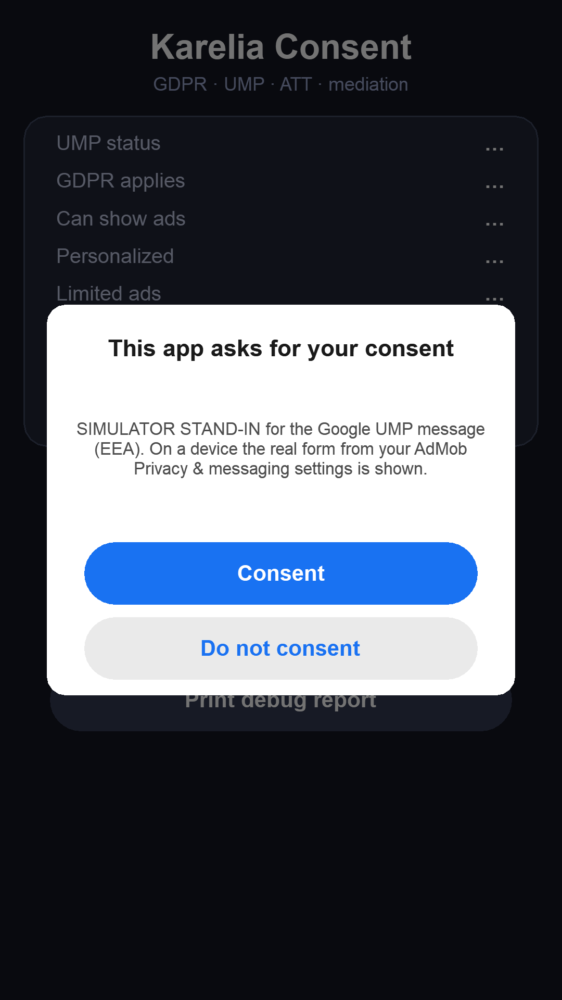
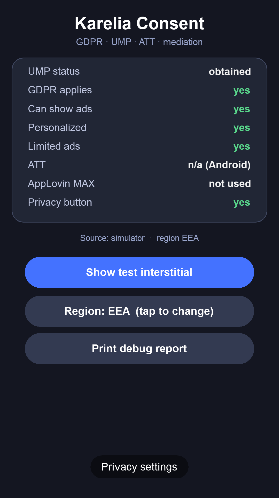
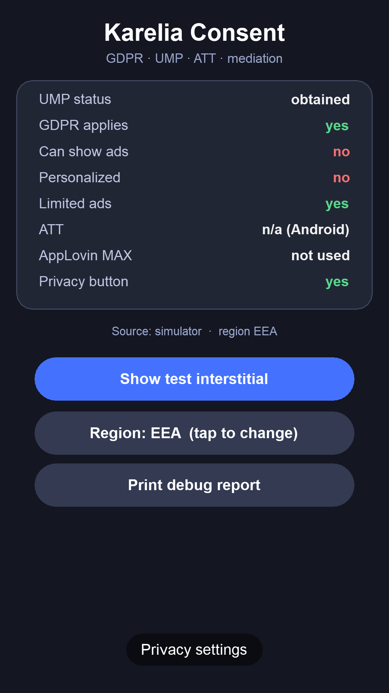

# Karelia Consent for Solar2D

Ad consent that passes review, in one call. Karelia Consent runs the whole GDPR / Google UMP / App Tracking Transparency flow on top of the **official, free** `plugin.admob` and `plugin.att`, then passes the answer to AppLovin MAX, Unity LevelPlay and Appodeal.

- **One call:** `consent.start( onReady )` updates UMP, waits for a real status, shows the form when needed, waits until it is really closed, asks for ATT, forwards the answer and calls you back. It always calls back, also on errors and timeouts, so your game never hangs on consent.
- **ATT after the consent form, never on top of it.** On iOS, `plugin.admob` reports the form as `hidden` right before it appears. Code that waits for `hidden` therefore shows the ATT popup over the consent form, a known App Store rejection. Karelia Consent ignores that early event.
- **Privacy settings button.** `consent.newPrivacyButton()` re-opens the form so users can change or withdraw consent at any time. Apple and Google both expect this, and the button only appears for users the message applies to (EEA/UK/CH, US states).
- **Real answers from the TCF string.** `canShowAds()`, `canShowPersonalizedAds()`, `canShowLimitedAds()` and per-vendor checks follow Google's published TCF rules for AdMob.
- **Mediation:** calls `setHasUserConsent()` on AppLovin MAX and Unity LevelPlay with the right vendor ids, and gives you `appodealParams()` for `appodeal.init()`.
- **Works in the Simulator.** `plugin.admob` does nothing on the desktop. Karelia Consent shows a stand-in form there and writes the same IABTCF keys a real CMP writes, so you can test "yes", "no" and US users without a phone.

Google UMP is a Google-certified CMP. Google requires one for personalized ads in the EEA and UK since 16 January 2024, and in Switzerland since 31 July 2024.

## Requirements

- Solar2D 2023.3686 or newer (the UMP functions in `plugin.admob` arrived in 3686).
- `plugin.admob` in `build.settings`, and a GDPR message published under **AdMob > Privacy & messaging** for your app. You need this even if you only show AppLovin or Unity ads; UMP is configured in AdMob.
- iOS: `plugin.att` and `NSUserTrackingUsageDescription` if you want the ATT prompt.

## Install

1. Add the `plugin.kareliaConsent` entry from your marketplace account to `build.settings`, next to AdMob:

```lua
settings = {
    plugins = {
        ["plugin.admob"] = { publisherId = "com.coronalabs" },
        ["plugin.att"]   = { publisherId = "com.solar2d", supportedPlatforms = { iphone = true, ["iphone-sim"] = true } },
        -- ["plugin.kareliaConsent"] = { ... }  -- paste from the marketplace
    },
    iphone = { plist = {
        GADApplicationIdentifier = "ca-app-pub-XXXXXXXXXXXXXXXX~YYYYYYYYYY",
        NSUserTrackingUsageDescription = "Your data will be used to show you more relevant ads.",
    } },
    android = { applicationChildElements = {
        [[<meta-data android:name="com.google.android.gms.ads.APPLICATION_ID" android:value="ca-app-pub-XXXXXXXXXXXXXXXX~YYYYYYYYYY"/>]],
    } },
}
```

2. In `main.lua`:

```lua
local admob = require "plugin.admob"
local consent = require "plugin.kareliaConsent"

consent.init{
    admob = admob,
    -- networks = { applovinMax = require "plugin.applovinMax" },
    -- debug = { geography = "EEA", testDeviceIdentifiers = { "YOUR-HASHED-ID" } },  -- testing only
}

-- Wrap your AdMob listener: UMP events go to Karelia Consent, everything still reaches you.
admob.init( consent.listener( function( event )
    -- your normal ad events
end ), { appId = "ca-app-pub-XXXXXXXXXXXXXXXX~YYYYYYYYYY" } )

consent.start( function( result )
    if result.canShowAds then
        admob.load( "interstitial", { adUnitId = "ca-app-pub-XXXXXXXXXXXXXXXX/ZZZZZZZZZZ" } )
    end
end )

-- Somewhere in your settings or pause menu:
consent.newPrivacyButton{ x = display.contentCenterX, y = display.contentHeight - 40 }
```

`consent.start()` can be called right away. When the listener is wrapped it waits for AdMob's `init` event by itself.

## API

| Call | What it does |
|---|---|
| `consent.init( options )` | Sets options (table below). Returns the library. |
| `consent.listener( fn )` | Returns a listener for `admob.init()`. Pass your own listener as `fn`. |
| `consent.start( onReady )` | Runs the flow once per launch. `onReady( result )` is called exactly once. If the flow already finished, it is called immediately. |
| `consent.showPrivacyOptions( onDone )` | Re-opens the form. `onDone( result )` gets the new answer, already forwarded to your networks. Returns `false` while the flow is busy. |
| `consent.newPrivacyButton( params )` | A ready-made button that calls `showPrivacyOptions()`. Returns `nil` when no message applies (pass `always = true` to force it). `params`: `x`, `y`, `parent`, `label`, `font`, `fontSize`, `width`, `height`, `fillColor`, `labelColor`, `onChange`. |
| `consent.canRequestAds()` | UMP's "can request ads": an answer exists or none is needed. |
| `consent.canShowAds()` | Personalized or non-personalized ads are allowed. |
| `consent.canShowPersonalizedAds()` | Consent for TCF purposes 1, 3, 4 plus 2, 7, 9, 10 (consent or legitimate interest) for Google. |
| `consent.canShowLimitedAds()` | Only legitimate interest is available: Google may serve limited ads. |
| `consent.privacyOptionsRequired()` | `true` for users in GDPR scope or in a US state with a privacy message. |
| `consent.networkAllowed( name )` | `"admob"`, `"applovinMax"`, `"unityads"`, `"appodeal"` or your own name from `options.networks`. |
| `consent.appodealParams( params )` | Returns `params` with `hasUserConsent` set, for `appodeal.init()`. |
| `consent.hasPurposeConsent( n )`, `hasVendorConsent( id )`, `hasAdditionalConsent( id )` | Raw TCF checks. Vendor ids are IAB Global Vendor List ids; additional consent ids are Google ATP ids. |
| `consent.getTCF()` | All IABTCF / IABGPP values as a table. |
| `consent.getResult()`, `consent.isReady()` | Last result, and whether the flow finished. |
| `consent.debugReport()` | Text with the state and the last 60 log lines. Paste it into support requests. |
| `consent.testDeviceIdHint()` | Where to find the hashed device id for `debug.testDeviceIdentifiers`. |

### Options

| Option | Default | Meaning |
|---|---|---|
| `admob` | `require "plugin.admob"` | The AdMob plugin table. |
| `att` | `require "plugin.att"` on iOS | The ATT plugin table, or `false` to never ask. |
| `requestATT` | `"afterConsent"` | `"afterConsent"`: ask only if the user did not refuse in the GDPR message (or no GDPR message applies). `"always"`: ask after the form whatever the answer. `"never"`. |
| `networks` | none | `{ applovinMax = applovinMax, unityads = unityads, ... }`. Each table with `setHasUserConsent` gets the answer. |
| `vendors` | built in | Override vendor ids per network, e.g. `{ myNetwork = { tcf = { 123 }, ac = { 456 } } }`. |
| `underage` | `nil` | Passed to UMP (`tagForUnderAgeOfConsent`) and `setIsAgeRestrictedUser(true)` on networks that still have it. |
| `debug` | `nil` | Passed to UMP: `{ geography = "EEA" or "notEEA", testDeviceIdentifiers = { ... } }`. Remove before release. |
| `timeout` | `10000` | Milliseconds to wait for each UMP step before continuing. |
| `autoStart` | `false` | Start the flow by itself when AdMob reports `init`. |
| `listener` | none | Gets `{ name = "kareliaConsent", phase = ..., result = ... }` with phases `status`, `formShown`, `formDismissed`, `att`, `ready`, `changed`. |
| `log` | `true` | Print `[KareliaConsent]` lines. |
| `simulator` | `{ region = "EEA" }` | Simulator only: `region` `"EEA"`, `"US"` or `"other"`, `autoAnswer` `"accept"`/`"decline"`, `reset = true` to ask again. |

### Result table

```lua
{
    source = "ump" | "simulator" | "error",
    consentStatus = "obtained" | "notRequired" | "required" | "unknown",
    formStatus = "available" | "unavailable" | "unknown",
    gdprApplies = true | false | nil,
    usApplies = boolean, usOptedOut = boolean,
    canRequestAds, canShowAds, canShowPersonalizedAds, canShowLimitedAds = boolean,
    privacyOptionsRequired = boolean,
    att = "authorized" | "denied" | "restricted" | "notDetermined" | "unavailable" | nil,
    networks = { admob = boolean, applovinMax = boolean, ... },
    error = nil | "text",
    tcf = { ... },   -- raw IAB values
}
```

## Vendor ids used

| Network | Ids |
|---|---|
| AdMob | Google Advertising Products, GVL 755 |
| AppLovin MAX | Google Additional Consent 1301 (AppLovin is not in the IAB list) |
| Unity LevelPlay / Unity Ads | GVL 1549 (Unity Technologies SF), Additional Consent 2878 (ironSource Mobile) and 3234 (Unity Ads) |
| Appodeal | purpose 1 only |

Sources: IAB Global Vendor List v181 (2026-10-15) and Google's Additional Consent provider list. Ids rarely change, but you can override them with `options.vendors`.

## Testing on a device

1. Keep AdMob's test ad unit ids during development.
2. Pass `debug = { geography = "EEA", testDeviceIdentifiers = { "..." } }`. Get the hashed id with `print( consent.testDeviceIdHint() )`.
3. UMP remembers the answer. To see the form again, uninstall the app or tap the privacy button.
4. If something looks wrong, `print( consent.debugReport() )` and send it with your question.

## Good to know

- Google UMP's `privacyOptions` form is not exposed by `plugin.admob`. Karelia Consent re-opens the regular consent form instead, which lets users change every choice. If a future `plugin.admob` adds privacy options, an update will switch to it.
- UMP has no reset in `plugin.admob`; uninstalling the app resets it.
- In the EEA, when the user refuses, Google still allows *limited ads* (`canShowLimitedAds`). Whether you load ads then is your choice; `canShowAds` stays `false`.

## Tested

- 20 automated tests run in the Solar2D Simulator 2026.3736 with mocks of `plugin.admob` (Android behaviour and the iOS "hidden before show" behaviour), `plugin.att`, AppLovin MAX and Unity LevelPlay, also against the compiled build that customers download.
- The TCF rules are checked against Google's published requirements, and the vendor ids against the IAB Global Vendor List v181 and Google's Additional Consent list.
- Device tests with the real UMP form on Android and iOS are the next step; until they are reported here, treat iOS as beta and test your own flow on a device before release.

## Support

support@karelialabs.atlassian.net, or the support link on the marketplace page. Include `consent.debugReport()`.

Copyright (c) 2026 Karelia Labs. Licensed under the marketplace EULA.


## Screenshots





## Get it

https://solar2dmarketplace.com/plugins?KareliaConsent_se-karelialabs
