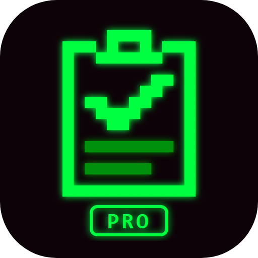
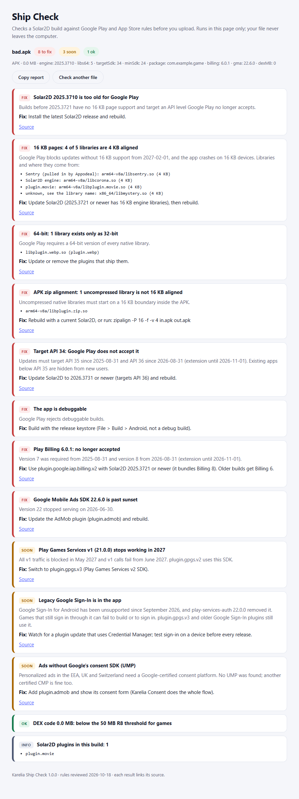
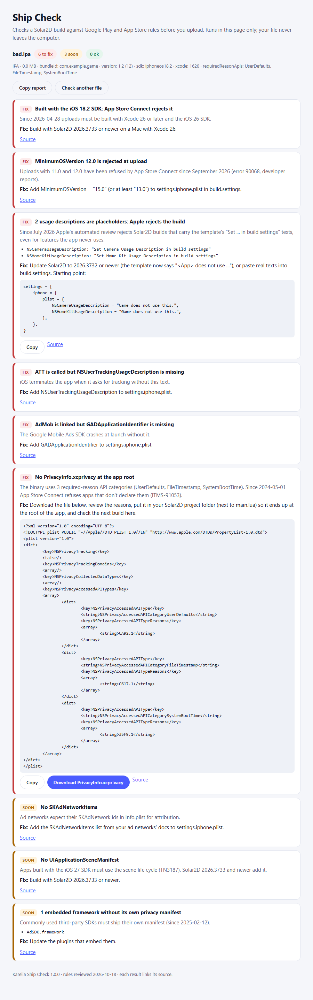
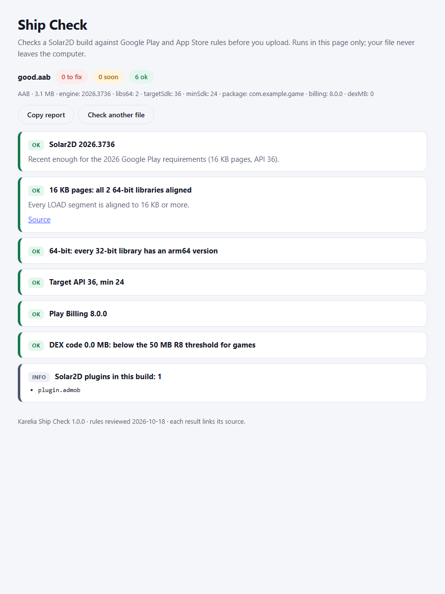

# Karelia Ship Check

Check a Solar2D build against Google Play and App Store rules **before** you upload it. Drop an `.apk`, `.aab` or `.ipa` on a page that runs offline in your browser. You get a report that says what will be rejected, which plugin causes it, and how to fix it.

Your file never leaves your computer: the page reads it with the browser's own zip and decompression support. No account and no install. A command-line version is included for CI.

## Two editions

| | Lite (free) | Pro |
|---|---|---|
| 16 KB memory pages, every 64-bit library, **named by plugin** | yes | yes |
| 64-bit versions of every library | yes | yes |
| Uncompressed libraries 16 KB aligned in the APK | yes | yes |
| Solar2D version (too old for Play?) and plugin list | yes | yes |
| Target API level (35/36) | | yes |
| Play Billing Library version (8 required) | | yes |
| Play Games Services v1 (blocked May 2027) and legacy Google Sign-In | | yes |
| Google Mobile Ads SDK sunset dates, consent SDK (UMP) present | | yes |
| Debuggable build, DEX size vs the R8 rule (Feb 2027) | | yes |
| **iOS:** Xcode 26 / iOS 26 SDK, MinimumOSVersion | | yes |
| **iOS:** placeholder usage descriptions that Apple's scan rejects, with a ready build.settings block | | yes |
| **iOS:** ATT text, AdMob GADApplicationIdentifier and SKAdNetworkItems | | yes |
| **iOS:** scene life cycle (iOS 27 SDK) | | yes |
| **iOS:** required-reason APIs found in the binary, plus a **generated PrivacyInfo.xcprivacy** | | yes |

## Use it

**Page:** open `app/index.html` in Chrome, Edge, Firefox or Safari and drop your build file. You can:

- **Copy report:** copies the whole report as text, ready for a forum post or a ticket.
- **Download PrivacyInfo.xcprivacy:** appears when an iOS build needs one. Put the file in your Solar2D project folder, next to `main.lua`. Solar2D then places it at the root of the `.app`. Run Ship Check on the next build to confirm.

**Command line (Node 18+):**

```
node app/cli.js MyGame.aab
node app/cli.js MyGame.ipa --manifest-out PrivacyInfo.xcprivacy
node app/cli.js MyGame.aab --json > report.json
node app/cli.js MyGame.aab --date 2027-02-02     (what will the report say on that day?)
```

The exit code is 1 when something must be fixed, so a CI job can stop a bad build.

## What the colours mean

- **Fix:** the store rejects the build, or will reject it after a date that has passed.
- **Soon:** a dated requirement that has not started yet. The date is in the text.
- **OK:** checked and fine.
- **Info:** facts such as the plugin list.

## How it reads your build

- **Native libraries:** reads the ELF headers of every `.so` and looks at the alignment of each LOAD segment. Libraries are matched to plugins by name. The table covers the Solar2D engine, all 358 plugins in the Solar2D plugin directory, and common SDKs (AppLovin, Sentry from Appodeal, Pangle, Crashlytics, Bugsnag).
- **Manifest:** decodes `AndroidManifest.xml`, both the APK binary format and the AAB protobuf format.
- **Library versions:** reads the `META-INF/*.version` files that Gradle adds for Google libraries.
- **Plugins:** found from their `plugin.<name>.LuaLoader` Java classes.
- **iOS:** reads `Info.plist` (binary or XML), scans the app binary for the API names Apple lists as "required reason" APIs, and checks for privacy manifests.

## Rules and dates

The rules were reviewed on 2026-10-18 and every result links its source. When a requirement has a date, the result switches from "Soon" to "Fix" on that day. Updates with new rules are free for buyers of the current version.

## Limits

- Ship Check reads what is in the file. It cannot see your store listing, data-safety form or AdMob console.
- **Required-reason APIs** are detected by name in the binary. Check the suggested reasons against what your app really does: each one is Apple's wording for the most common game use.
- **The iOS checks were tested with built test files,** not yet with an App Store build of a real Solar2D game. The Android checks use the real Solar2D 2026.3736 engine libraries.

## Support

support@karelialabs.atlassian.net. "Copy report" gives everything we need.

Copyright (c) 2026 Karelia Labs. Licensed under the marketplace EULA.


## Screenshots





## Get it

https://solar2dmarketplace.com/assets?KareliaShipCheckPro_se-karelialabs
