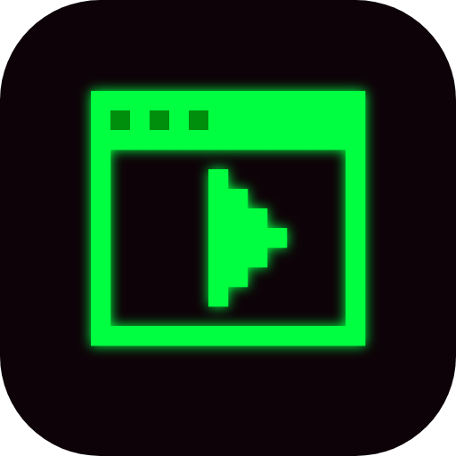
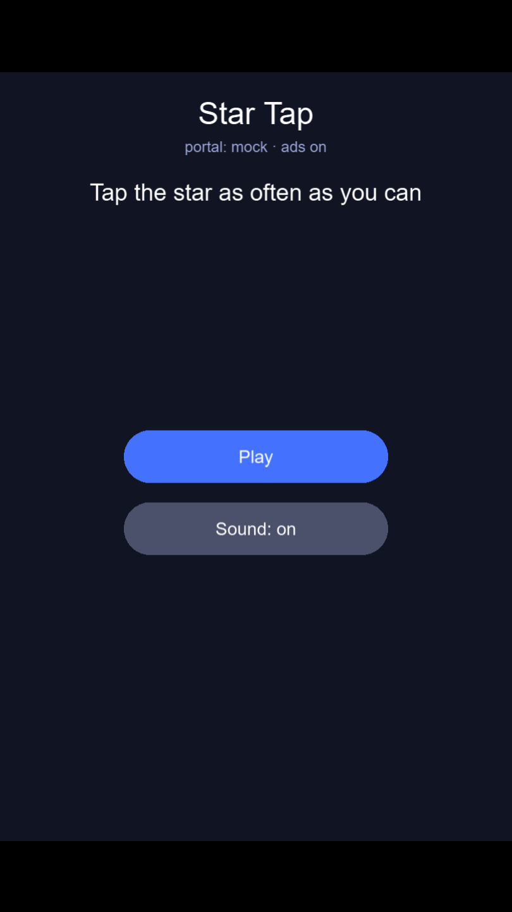
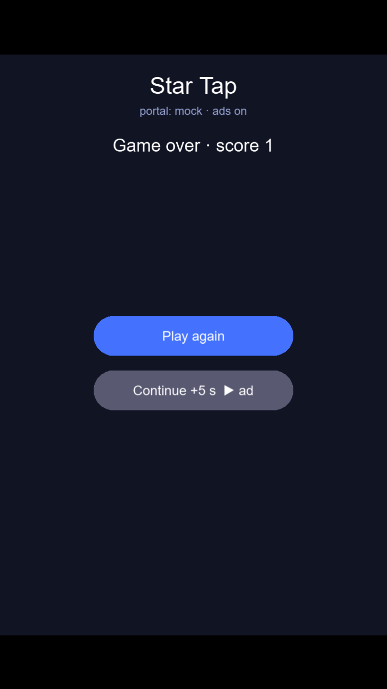
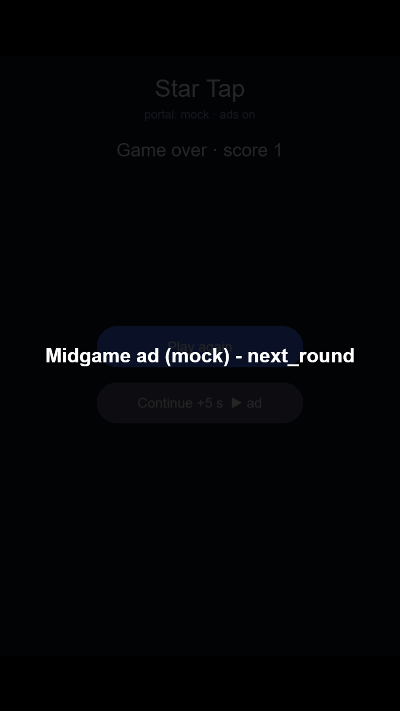
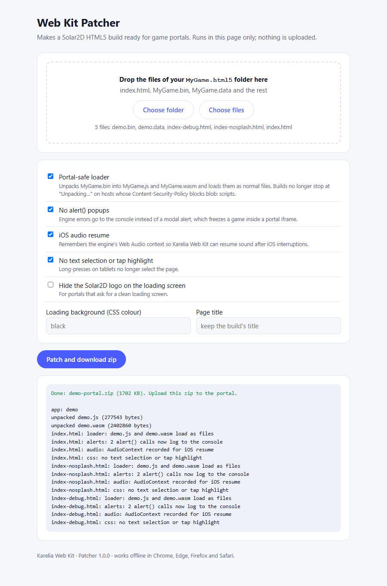

# Karelia Web Kit for Solar2D HTML5

Put your Solar2D game on web portals with one Lua API: **Poki, CrazyGames, GameDistribution, Google H5 Games Ads (AdSense) and Wavedash**. Plus the **Web Kit Patcher**, which fixes the HTML5 build itself so it loads on hosts with a strict Content-Security-Policy.

```lua
local webkit = require "kareliaWebKit"

webkit.init( { portal = "auto" }, function( info )
    webkit.loadingDone()
    showMenu()
end )

-- between rounds
webkit.ad( "next_level", function( result ) startLevel() end )

-- "continue for an ad" button
webkit.rewarded( "continue", function( result )
    if result.rewarded then giveExtraLife() end
end )

webkit.gameplayStart()   -- when play starts (first input)
webkit.gameplayStop()    -- pause, menu, level end, game over
```

## What it does for you

- **One API, five portals.** The kit picks the portal from the page address (`portal = "auto"`), or you can set it. It loads the portal's SDK from the portal's own CDN at run time.
- **Ads done the way portal QA expects.**
  - Audio is muted and touches are blocked while an ad runs. Your `onPause` / `onResume` callbacks are called so you can pause timers and physics.
  - A `gameplayStop` is sent before every break. Calls you make while an ad is open (e.g. `gameplayStart`) are delivered after it closes.
  - Two gameplay events in a row are dropped, and only one ad can be open at a time.
- **Rewarded ads that only reward a full view.** `result.rewarded` is `true` only when the portal confirms it.
- **Page fixes portals ask for.** Arrow keys and space no longer scroll the portal page, and tablets don't select text. On portals, `alert()` popups are turned into console warnings. Sound is muted while the tab is hidden, and CrazyGames' `muteAudio` setting is honoured.
- **Simulator and `?portal=mock`.** In the Solar2D Simulator ads are simulated, with buttons for "watched" and "closed early". In any browser, `?portal=mock` shows fake ad breaks, so the whole game flow can be tested before you upload.

## The Patcher: why your HTML5 build may show a black screen

A Solar2D HTML5 build loads its engine by unpacking `MyGame.bin` and starting it from a `blob:` URL. Hosts whose Content-Security-Policy does not allow `blob:` scripts block that, and the page stops at "Unpacking…".

The **Web Kit Patcher** unpacks `MyGame.bin` into `MyGame.js` and `MyGame.wasm` and loads them as normal files. Tested with a policy of `script-src 'self'` (no `blob:`): the original build stops at "Unpacking…", the patched build runs. It also:

- turns the engine's `alert()` calls into console errors
- records the Web Audio context so the kit can resume sound after iOS interruptions
- optionally sets the loading-screen background, removes the Solar2D logo and sets the page title

Two ways to run it:

- **Offline page:** open `patcher/index.html` in Chrome, Edge, Firefox or Safari, drop the files of your `MyGame.html5` folder, click **Patch and download zip**. Nothing is uploaded anywhere.
- **Command line (Node 18+):** `node patcher/patch.js path/to/MyGame.html5 --zip MyGame-portal.zip --hide-logo`

## Install

1. Copy `kit/kareliaWebKit.lua` and `kit/kareliaWebKit_js.js` into your project folder, next to `main.lua`. Solar2D loads JavaScript modules only from the project root.
2. `local webkit = require "kareliaWebKit"` and call `webkit.init()` early in `main.lua`.
3. Build: **File > Build > HTML5**.
4. Run the Patcher on the `.html5` output folder and upload the zip it gives you.

`project/` is a complete sample game ("Star Tap") using every call.

## API

| Call | Notes |
|---|---|
| `webkit.init( options, onReady )` | `onReady( info )` with `info.portal` ("poki", "crazygames", "gamedistribution", "google", "wavedash", "mock" or "none") and `info.ads`. Always called, also when the SDK cannot load (ad blockers): then `ads` is `false`. |
| `webkit.loadingProgress( 0..1 )` | Optional, while you load assets. CrazyGames `loadingStart`; Wavedash progress bar. |
| `webkit.loadingDone()` | Once, when the game is playable. Poki `gameLoadingFinished`, CrazyGames `loadingStop`, Wavedash `init` (Wavedash keeps its loading screen until this). |
| `webkit.gameplayStart()` / `webkit.gameplayStop()` | Deduplicated. Held back during ads. Poki wants `gameplayStart` on the player's first input, not on load. |
| `webkit.ad( name, onDone )` | Midgame break. `onDone( { shown, reason } )`. Portals cap frequency themselves; ask whenever there is a natural pause. |
| `webkit.rewarded( name, onDone )` | `onDone( { rewarded, shown, reason } )`. Reward only when `rewarded` is `true`. |
| `webkit.happyTime()` | CrazyGames celebration moment. Use sparingly. |
| `webkit.checkAdblock( onResult )` | `onResult( true/false )` (CrazyGames; `false` elsewhere). Never block play because of it. |
| `webkit.openLink( url )` | Uses `PokiSDK.openExternalLink` on Poki, which Poki requires; a normal link elsewhere. |
| `webkit.setMuted( bool )`, `webkit.isMuted()` | A mute toggle that survives ads and tab switches. Also tells Google H5 Ads whether the game has sound. |
| `webkit.portal()`, `webkit.adsAvailable()`, `webkit.isPlaying()`, `webkit.isReady()` | State. |
| `webkit.query( name )` | A URL query parameter on HTML5, "" elsewhere. |
| `webkit.debugReport()` | State and the last log lines, for support requests. |

### Options

| Option | Default | Meaning |
|---|---|---|
| `portal` | `"auto"` | Or force one. `?portal=xxx` in the page URL always wins (handy for testing). |
| `gameId` | none | GameDistribution game id. |
| `adClient` | none | Google H5 Games Ads publisher id, `"ca-pub-..."`. Google's product needs an approved AdSense account. |
| `test` | `false` | Google `data-adbreak-test="on"` (mock ads) / GameDistribution debug. |
| `frequencyHint` | none | Google `data-ad-frequency-hint`, e.g. `"60s"` (minimum 30s). |
| `onPause( e )`, `onResume( e )` | none | Called around ads (`e.reason = "ad"`). Pause timers, transitions, physics here. |
| `onSettings( e )`, `onVisibility( e )` | none | Portal settings changes (CrazyGames) and tab hidden/visible. |
| `muteDuringAds`, `muteWhenHidden` | `true` | Turn off if you handle audio yourself. |
| `fixes` | `true` | Scroll keys, wheel, text selection, iOS audio resume. |
| `suppressAlerts` | on portals | Replace `alert()` with console warnings. |
| `debug` | `false` | Console logging. Also lets `?kwk_adclient=` / `?kwk_gameid=` set ids, so one build can be tried on several portals. |
| `simulatorPortal` | `"mock"` | What the Simulator pretends to be (`"none"` to disable fake ads). |
| `mockAdSeconds` | `1.5` | Length of a simulated midgame ad. |
| `log` | `true` | Print `[KareliaWebKit]` lines. |

## Portal notes

- **Poki:** the SDK must be initialised before the game shows anything else. Upload the patched zip in Poki's developer area and use the Poki Inspector. Poki blocks external requests, so bundle fonts and images.
- **CrazyGames:** test locally on `localhost` (the SDK runs in "local" mode and shows text ads). Don't call `gameplayStop` just because the tab lost focus; CrazyGames handles that. A full implementation must honour `muteAudio`, which the kit does.
- **GameDistribution:** set `gameId`. Ads are shown on touch/click actions (Play, Replay, Next). Rewarded ads must be enabled in GameDistribution's developer dashboard.
- **Google H5 Games Ads:** needs approval. Use `test = true` until approved. Mobile apps and native builds are not supported by this product.
- **Wavedash:** Wavedash shows its loading screen until `loadingDone()`.

## Tested

- **End to end:** the demo was built with Solar2D 2026.3736 for HTML5 and patched, then served with a strict Content-Security-Policy. It ran in headless Chromium against documented-behaviour stand-ins for every portal SDK. For each portal the test checks:
  - the exact SDK calls and their order
  - audio muted during ads and restored afterwards
  - queued gameplay events
  - no page errors or alerts
- **The live portal SDKs have not been called;** that needs an account on each portal.

## Support

support@karelialabs.atlassian.net. Please include `webkit.debugReport()`.

Copyright (c) 2026 Karelia Labs. Licensed under the marketplace EULA.


## Screenshots






## Get it

https://solar2dmarketplace.com/assets?KareliaWebKit_se-karelialabs
